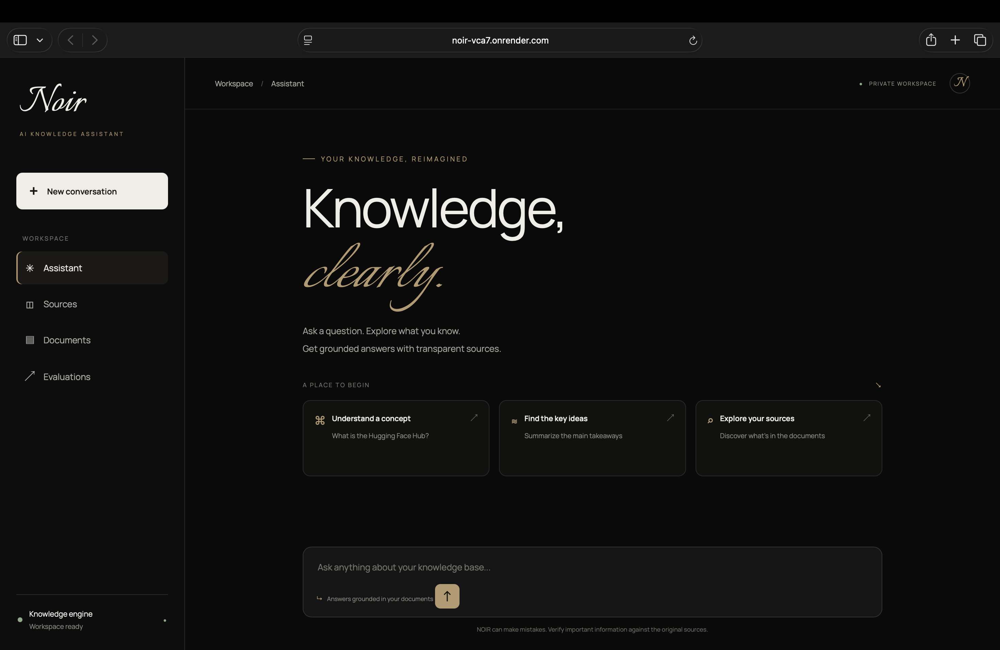
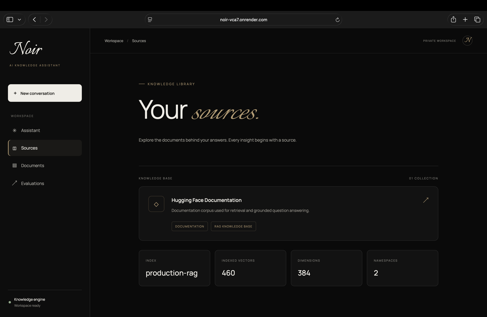
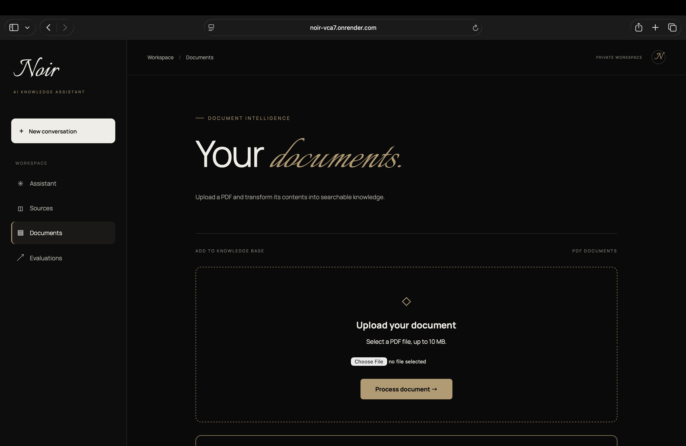
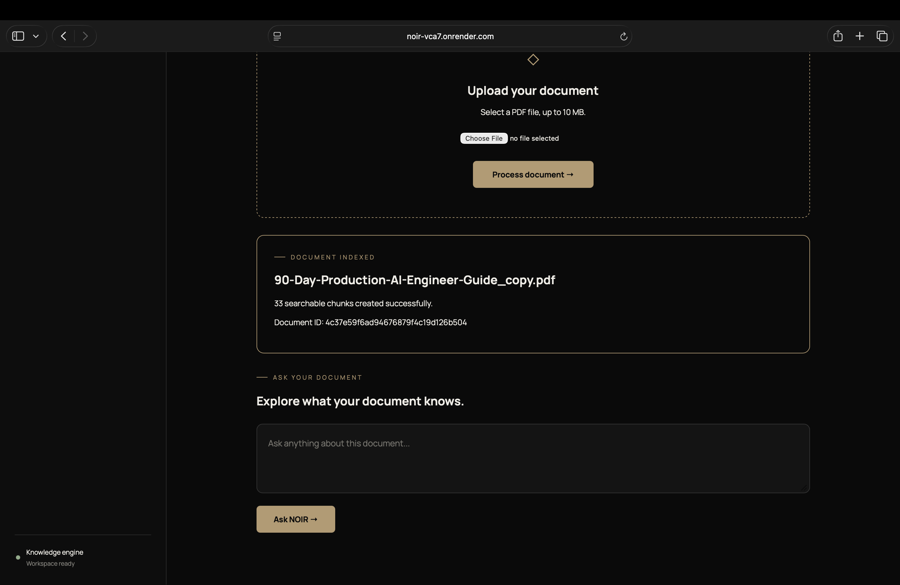
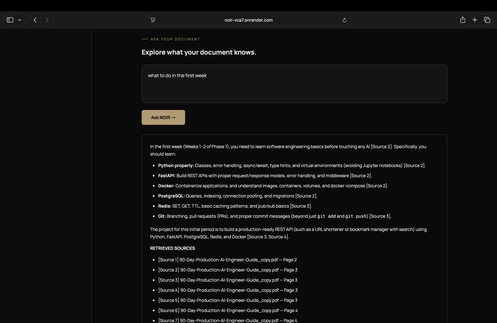

## Application Screenshots

### AI Knowledge Assistant

The main NOIR workspace provides a minimal interface for asking questions and exploring knowledge.

### Knowledge Sources

Explore the indexed knowledge base and its vector database configuration.

### PDF Document Upload

Upload PDF documents to create a searchable knowledge base.

### Document Indexing

NOIR extracts document text, creates chunks, generates embeddings, and indexes them in Pinecone.

### Document Question Answering

Ask natural-language questions about uploaded documents and receive AI-generated answers with page-level citations.

